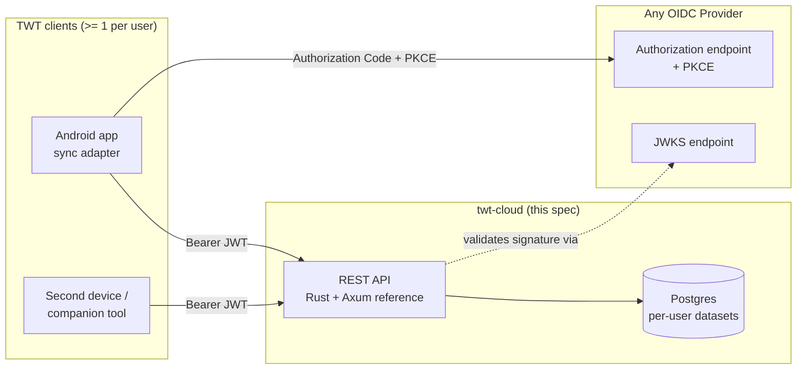

# TrackWorkTime Cloud Storage Backend — Design

Status: draft v1.1 (2026-10-12)
Normative API contract: [`openapi.yaml`](openapi.yaml) (OpenAPI 3.1)

## 1. Purpose and scope

TrackWorkTime (TWT) is an offline-first, single-user Android app that stores work-time
events in a local SQLite database (`MySQLiteHelper.java`, version 6). The app lives in
the [twt-cloud repository](https://git.faxen.eu/qdulf/twt-cloud); the app source paths
quoted below are relative to `app/` there. Data leaves the device in two ways: via
manual CSV backup to a user-granted document tree (`DocumentTreeStorage.java`,
`BackupUtil.java`) and via the cloud sync built into the app (`sync/CloudSyncManager.java`,
`sync/CloudAuthManager.java`).

This document defines a **cloud storage backend** that:

1. supports **multiple clients per user** (phone + tablet + desktop companion, N devices),
2. exposes a **REST API** (JSON over HTTPS),
3. authenticates clients via **OIDC** (the backend acts as an OAuth 2.0 Resource Server;
   users log in through any standard OIDC provider — Keycloak, Auth0, Google, …),
4. stays a *storage* backend: all timer/flexi/reporting logic remains in the app. The
   server never computes worked time; it stores and synchronizes the app's own records.

Out of scope: multi-user team features, server-side reporting, push notifications
(optional extension, see §12).

## 2. Grounding: the app's data model (as read from the source)

The backend must round-trip the app's data losslessly. The authoritative structures
extracted from the repo (commit `daf69ab`, 2026-10-03):

### 2.1 Tables (MySQLiteHelper, DATABASE_VERSION 6)

```sql
tasks(_id INTEGER PK AUTOINCREMENT, name TEXT NOT NULL, active INTEGER NOT NULL,
      ordering INTEGER NULL, isdefault INTEGER NOT NULL DEFAULT 0,
      uuid TEXT NULL)                      -- v6: canonical cloud identity

events(_id INTEGER PK AUTOINCREMENT,
       time      INTEGER NOT NULL,   -- epoch seconds (exact to the second)
       zone_offset INTEGER NOT NULL, -- UTC offset in MINUTES
       type      INTEGER NOT NULL,   -- 1 = CLOCK_IN, 0 = CLOCK_OUT (-1 = virtual CLOCK_OUT_NOW, never stored)
       task      INTEGER NULL,       -- FK -> tasks._id; null on clock-out events
       comment   TEXT NULL,
       uuid      TEXT NULL)          -- v6

targets(_id INTEGER PK AUTOINCREMENT,
        time  INTEGER NOT NULL,     -- epoch DAYS (a LocalDate)
        type  INTEGER NOT NULL,     -- 0 DAY_SET, 1 DAY_GRANT, 2 DAY_IGNORE, 5 FLEXI_SET, 6 FLEXI_ADD
        value INTEGER NULL,         -- target work time in MINUTES
        comment TEXT NULL,
        uuid  TEXT NULL)            -- v6

cache(_id INTEGER PK, worked INTEGER NOT NULL, target INTEGER NULL)  -- derived cache, NOT synced

outbox(_id INTEGER PK AUTOINCREMENT, op_id TEXT NOT NULL UNIQUE,    -- v6: pending push ops
       entity TEXT NOT NULL, row_uuid TEXT, kind TEXT NOT NULL, payload TEXT NOT NULL)
```

Key facts (with sources):

* Event `time` is stored as epoch seconds, exact to the second; the DAO truncates to
  whole minutes only when *reading* (`DAO.cursorToEvent`). `zone_offset` is stored in
  **minutes**, not seconds (`DAO.eventToContentValues`: `getTotalSeconds() / 60`).
* `type` numeric values come from `TypeEnum.Values`: `CLOCK_IN_VALUE = 1`,
  `CLOCK_OUT_VALUE = 0`, `CLOCK_OUT_NOW_VALUE = -1` — and `CLOCK_OUT_NOW` "NEVER COMES
  FROM THE DATABASE"; it is synthesized for display. The API therefore accepts only
  `CLOCK_IN`/`CLOCK_OUT` and rejects `-1`.
* `TargetEnum` values: `DAY_SET = 0`, `DAY_GRANT = 1`, `DAY_IGNORE = 2`,
  `FLEXI_SET = 5`, `FLEXI_ADD = 6`. `value` is **minutes** of target work time
  (`TimeCalculatorV2.calculateTargetTime` uses it directly as minutes; migration code in
  `DAO` converts flex events to `hour*60 + minute`).
* `tasks.ordering` is nullable and marked "for future use"; `active`/`isdefault` are 0/1
  integers.
* A task can be deleted while events still reference it (`DAO.deleteTask` performs no
  cascade check) — the API keeps this looseness (see §7.3).

### 2.2 Backup CSV formats (for migration & compatibility)

The app's backup writes three CSVs (`BackupFileInfo`): `backup.events`,
`backup.targets`, `backup.preferences`.

* **events**: header `type;time;task;comment;taskId;name;active;ordering;isdefault`,
  then one row per event (with its task) plus one row per task that has no events
  (FULL OUTER JOIN via UNION ALL in `DAO.getAllEventsAndTasks`). Type is the localized
  readable name (`in`/`out` in `values/strings.xml`); time is `ISO_OFFSET_DATE_TIME`.
* **targets**: header `time;type;value;comment`; `time` is `ISO_LOCAL_DATE`, type is the
  enum's readable name (`day-set`, `day-grant`, `day-ignore`, `flexi-set`, `flexi-add`).
* **preferences**: lines of `key;type;value` written by
  `PreferencesUtil.writePreferences`, where type ∈ {`string`, `stringset`, `boolean`,
  `integer`, `float`, `long`}.

The backend's `/backup/*` endpoints (§8) speak exactly these formats, so an existing
CSV backup can be imported with zero client-side changes, and the app can adopt the
cloud backend by swapping its `DocumentTreeStorage` writes for HTTP PUTs.

## 3. Architecture overview



* Each **user** is identified by the OIDC `sub` claim. All rows are scoped by `user_id`.
* Each device installation registers as a **client** and gets a `client_id` (UUID).
* The server is stateless apart from the datastore; horizontal scaling only needs
  sessionless JWT validation and a shared database.

## 4. Identity model (OIDC)

### 4.1 Roles

* **OIDC Provider (IdP)** — any conformant implementation. Owns login UIs, sessions,
  MFA, password resets. The backend never sees credentials.
* **twt-cloud** — OAuth 2.0 *Resource Server*. Accepts bearer access tokens, validates
  them, and maps `sub` → internal `user_id`.
* **TWT app** — OAuth 2.0 *public client* (no client secret; uses Authorization Code +
  PKCE as required for mobile native apps, RFC 8252).

### 4.2 Token validation (server-side, mandatory)

The resource server validates every request's `Authorization: Bearer <jwt>`:

| check | rule |
|---|---|
| signature | verified against JWKS fetched from the issuer's `jwks_uri` (discovered via `/.well-known/openid-configuration`), cached with refresh |
| `iss` | must equal the configured issuer, exact string match |
| `aud` | must contain the configured audience (the API's `client_id` at the IdP) |
| `exp` / `nbf` | enforced with ~30 s clock skew allowance |
| `alg` | server-side pinned to the RSASSA family (`RS256`/`RS384`/`RS512`); the token header's algorithm claim is never trusted |
| `sub` | required; becomes the user identifier |

Recommended claim set issued by the IdP: `iss`, `sub`, `aud`, `exp`, `iat`, `scope`.
The IdP issues tokens with the scopes the deployment configures; `GET /config`
advertises `openid`, `profile`, `offline_access`. The server decodes `scope` but
does not enforce it; the `aud` check is the access-control gate.

For local development and integration tests, deployments MAY accept a **static JWKS**
from a local file, so no IdP is needed to exercise the API. Because a static file
trusts a keypair that may not be operator-owned, the server refuses to boot with
`OAUTH_JWKS_FILE` set unless `I_ACCEPT_DEV_JWKS=1` explicitly accepts the risk;
dev keys are generated per developer by `backend/dev/gen-dev-keys.sh` and never
committed.

### 4.3 Client registration flow

On first launch (or first sync setup), the app needs no manual configuration: it
boots its login from the backend URL alone.

1. fetches the unauthenticated bootstrap document `GET /api/v1/config`, which returns
   the OIDC `issuer` URL, the public `clientId`, the `scopes` to request, and the
   OAuth `flow` to run (constant `authorization_code_pkce`),
2. runs OIDC discovery on the issuer: `issuer + ".well-known/openid-configuration"`
   (the issuer ends with `/`) yields the IdP's authorization and token endpoints and
   JWKS location; browser clients may fetch the same document through
   `GET /api/v1/oidc-config`, because IdPs do not necessarily allow CORS on it,
3. completes the OIDC Authorization Code + PKCE dance via `androidx.browser` Custom
   Tabs (library choice: OpenID's AppAuth for Android) using the discovered endpoints,
   `clientId` and `scopes`; browser clients may relay the code/refresh grant through
   `POST /api/v1/oauth/token` for the same CORS reason as the discovery document,
4. obtains a refresh token (offline access) + access token, and stores both plus the
   config so the client can refresh tokens automatically without user interaction,
5. calls `POST /api/v1/clients` with a user-chosen device label; server returns a
   persistent `client_id` (UUID).

`client_id` is a *sync-era* concept: it identifies the installation (survives
re-login), is attached to every pushed operation for audit and conflict metadata, and
can be revoked by the user (`DELETE /api/v1/clients/{id}` marks it revoked; future
pushes from it are rejected).

## 5. Cloud data model

The server stores per-user versions of the app's entities, plus sync bookkeeping.
UUIDs (client-generated, v4) are the canonical cross-device identity; the integer
autoincrement IDs remain purely local to each device.

```sql
users(id BIGINT GENERATED ALWAYS AS IDENTITY PK,    -- projected from IdP; no password data
       sub TEXT NOT NULL UNIQUE, created_at)

clients(client_id UUID PK, sub TEXT, label TEXT,
        created_at, last_seen_at, revoked_at NULL)

tasks(id UUID PK, user_id, name, active BOOLEAN, ordering INT NULL,
      is_default BOOLEAN, updated_at, deleted_at NULL)

events(id UUID PK, user_id, time INT, zone_offset INT,
       type TEXT CHECK(type IN ('CLOCK_IN','CLOCK_OUT')),
       task UUID NULL, comment TEXT NULL, updated_at, deleted_at NULL,
       insertion_seq BIGINT NOT NULL)  -- per-user arrival order; tiebreak
                                       -- for same-time events (app: _id order)

targets(id UUID PK, user_id, date DATE, type TEXT CHECK(type IN
       ('DAY_SET','DAY_GRANT','DAY_IGNORE','FLEXI_SET','FLEXI_ADD')),
       value INT NULL, comment TEXT NULL, updated_at, deleted_at NULL)

preferences(user_id, key TEXT, value JSONB, updated_at,
            PRIMARY KEY (user_id, key))        -- LWW per key

change_log(seq BIGINT PK AUTOINCREMENT,        -- global, monotonic per user
           user_id, entity TEXT, entity_id UUID, op TEXT,
           payload JSON, origin_client UUID, occurred_at)

change_retention(user_id PK, purged_through_seq BIGINT, purged_at)  -- retention high-water mark

processed_ops(client_id, op_id, PRIMARY KEY(client_id, op_id))  -- idempotency ledger
```

Design notes:

* `events.task` references `tasks.id` (UUID) — the same loose FK the app has. Not
  enforced at ingest (an offline client may push an event before the referenced task);
  referential integrity converges as changes sync (§7.1).
* `preferences` uses JSON values to mirror the typed CSV format (`string`, `integer`, …).
* `cache` is **not** synced — it is a pure derived cache; each device rebuilds it.
* `updated_at` (RFC 3339, client wall clock at mutation time) drives LWW (§7.2).

## 6. REST API surface (summary)

Full normative contract in `openapi.yaml`. All paths under `/api/v1`, all responses
JSON, errors as RFC 9457 `application/problem+json`.

| group | endpoints |
|---|---|
| Discovery | `GET /healthz` (unauthenticated), `GET /config` (unauthenticated) |
| Identity | `GET /me` |
| Clients | `GET /clients`, `POST /clients`, `DELETE /clients/{clientId}` |
| Tasks | `GET/POST /tasks`, `GET/PATCH/DELETE /tasks/{id}` |
| Events | `GET/POST /events`, `GET/PATCH/DELETE /events/{id}` |
| Targets | `GET/POST /targets`, `GET/PATCH/DELETE /targets/{id}` |
| Preferences | `GET /preferences`, `PUT /preferences/{key}` |
| Sync | `GET /sync/changes?cursor=`, `POST /sync/push`, `GET /sync/state` |
| Backup-compat | `GET/PUT /backup/{events|targets|preferences}` (CSV, §8) |
| Import/export | `GET /export`, `PUT /import` (full JSON snapshot) |

Every mutation (through CRUD *or* sync) appends to the user's change log, so both
interfaces stay consistent.

## 7. Sync protocol

### 7.1 Change log and cursors

Each user has a monotonically increasing `seq`. A **change record** is:

```json
{
  "seq": 42,
  "entity": "event",
  "id": "0d4c1a2e-...",
  "op": "upsert",
  "data": { "...entity fields...": 0 },
  "origin": "9f3c...-clientId",
  "occurredAt": "2026-10-05T09:12:33Z"
}
```

Clients pull with `GET /sync/changes?cursor=<lastSeq>&limit=500`, receiving at most
`limit` records plus the new cursor. `hasMore` signals more data. `cursor=0` replays
from the beginning (initial device sync).

Deletes appear as `op: "delete"` changes. A background job purges change-log
entries older than `RETENTION_DAYS` (default 180 days) and records, per user,
the highest purged `seq` in `change_retention`. A client whose last cursor
falls inside the purged range (`cursor < purged_through_seq`) gets `410 Gone`
problem+json — `type: "cursor-expired"`, `title: "Sync cursor expired"`,
`detail: "The requested cursor predates the retained change history."` — and
must re-baseline via `GET /export` or a fresh full pull. `cursor=0` never
triggers `410`: it replays whatever history is still retained.

### 7.2 Push, idempotency, conflicts

`POST /sync/push` carries a batch:

```json
{
  "clientId": "…",
  "batchId": "…",
  "operations": [
    { "opId": "…", "op": "upsert", "entity": "event",
      "data": { "id": "…", "time": 1759600800, "zoneOffset": 120,
                "type": "CLOCK_IN", "task": "…", "comment": null,
                "updatedAt": "2026-10-05T07:12:00Z" } }
  ]
}
```

Server behavior per operation:

1. **Idempotency**: `(clientId, opId)` already seen → result `duplicate`, no state
   change, no new change-log entry. Replayed batches are therefore safe on flaky
   networks.
2. **Validation**: invalid entity (e.g. `type: "CLOCK_OUT_NOW"`, non-integer `time`)
   → `rejected` with a reason; the rest of the batch still applies.
3. **LWW**: if the stored row's `updatedAt` is newer than the pushed one, result is
   `ignoredStale` and the current server row is returned for reconciliation.
   Otherwise apply, write a change-log entry, return `applied`.

Response: per-op results aligned with request order, plus the user's new `cursor`.

Batch limits: ≤ 1000 operations, ≤ 1 MiB body (413 otherwise). Recommended client
batching: push after every local mutation set (the app already funnels all writes
through `TimerManager.createEvent` / `DAO.updateEvent` etc., which is where the sync
adapter hooks in).

### 7.3 Conflict policy rationale

TWT data is append-mostly (a clock-in/out stream) and edits are rare, so last-writer-
wins on `updatedAt` is sufficient and predictable. Deletes always win (tombstone
beats later update is *not* assumed; instead a delete is itself a change with an
`updatedAt`, so a truly newer edit resurrects the row — matching the app's own "events
are rows" mental model).

Referential looseness (events → task UUID) mirrors the app: a deleted task's events
keep their `task` reference; both sides treat it as data, not an integrity violation.

## 8. CSV backup compatibility

`GET /backup/events` streams the exact CSV the app produces today (header from
`DAO.backupEventsToWriter`), including the localized `in`/`out` type names and
`ISO_OFFSET_DATE_TIME` timestamps — sourced from the *server's* canonical store, so a
second device can round-trip it through `DAO.restoreEventsFromReader` unchanged.
`PUT /backup/events` accepts such a CSV and upserts (imports) it.

This gives three adoption paths, in increasing fidelity:

1. **Drop-in backup target**: keep the app's backup code, write the CSVs to the cloud
   instead of (or in addition to) the document tree.
2. **Manual migration**: upload an existing `backup.*` CSV via `PUT /backup/*`, then
   switch the device to native sync.
3. **Native sync**: full entity model, cursors, multi-device.

## 9. Security

* **Transport**: TLS only. Deployment SHOULD place the API behind a reverse proxy
  (e.g. Caddy/nginx) terminating TLS; the service itself binds to loopback or an
  internal interface.
* **Auth**: Bearer JWT as §4.2; 401 carries `WWW-Authenticate: Bearer error="invalid_token"`.
* **Authorization**: every query is scoped by `sub`; cross-user access is impossible by
  construction (single-tenant-per-row isolation + tested).
* **PKCE**: enforced client-side by the app (S256), standard for public clients.
* **Rate limits** (recommended proxy-level): 10 req/s sustained per token, 100 req/s
  burst; 429 with `Retry-After`.
* **Data protection**: at-rest encryption recommended (SQLCipher / Postgres TDE);
  per-user export/delete endpoints enable GDPR data-portability/erasure workflows
  (`DELETE /clients/{id}` plus a future `DELETE /me` admin path).
* **Audit**: change log *is* the audit trail (who/when/what per row).

## 10. Android client integration

Implemented as `sync/CloudSyncManager` + `sync/CloudAuthManager`; no change to
timer logic.

* Trigger: `Basics.periodicHook` (≈ once a minute) calls `scheduleSync()`; runs are
  serialized on a single background executor thread and concurrent requests collapse
  into one pending run.
* Push: the `outbox` table (v6) holds pending operations (`DAO.enqueueTaskOp` /
  `enqueueEventOp` / `enqueueTargetOp` on every mutation); `pushDrain` reads batches of
  500, `POST /sync/push`es them, and deletes rows whose results come back
  `applied` / `duplicate` / `rejected`. Each row carries a client-generated `uuid`
  (v6 column) as its cloud identity.
* Pull: `GET /sync/changes?cursor=<seq>` pages changes, applying each record via
  `DAO.upsertTaskFromCloud` / `upsertEventFromCloud` / `upsertTargetFromCloud`
  (keyed by `uuid`, no separate mapping table). Changes originating from this client
  are skipped (feedback-loop guard). Cursor + `clientId` persist in SharedPreferences
  `twt_cloud_sync`.
* Re-baseline: HTTP 410 on pull raises `SyncResetException` — the run aborts and is
  logged; recovery is manual today (clear the stored cursor / `initialSyncDone` flag
  so the next run re-enqueues all rows and pulls from `cursor=0`).

## 11. Document verification

The OpenAPI contract is validated with `openapi-spec-validator`:

```sh
uv run --with openapi-spec-validator openapi-spec-validator docs/openapi.yaml
```

A reference server implementation is shipped in `backend/` (Rust + Axum + sqlx +
Postgres), with integration tests in `backend/tests/` (`sync.rs`, `events.rs`,
`csv_roundtrip.rs`) and CI in `.github/workflows/backend-tests.yaml`
(`cargo test --all-targets`, `cargo clippy -- -D warnings`). Conformance to this
spec is enforced there, not by `openapi-core` request/response validation.

## 12. Extension points (explicitly out of scope for v1)

* WebPush notify on remote changes (the `clients` table already carries the needed
  registration point).
* Server-side aggregates (weekly totals) — deliberately rejected: the app's
  `TimeCalculatorV2` owns that logic.
* Team/multi-user reporting on top of per-user datasets.
